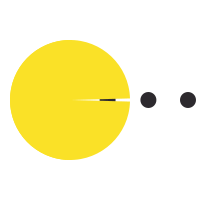

<!--
**fenlyin0420/Fenlyin0420** is a ✨ _special_ ✨ repository because its `README.md` (this file) appears on your GitHub profile.

Here are some ideas to get you started:

- 🔭 I’m currently working on ...
- 🌱 I’m currently learning ...
- 👯 I’m looking to collaborate on ...
- 🤔 I’m looking for help with ...
- 💬 Ask me about ...
- 📫 How to reach me: ...
- 😄 Pronouns: ...
- ⚡ Fun fact: ...
-->
# 👋🏻 Hey,

	 
	

# I am Fenlyin. 
## I build model engines, and make LLMs cheaper to run

-  I write Python and PyTorch every day, and I care a lot about what happens underneath a `forward` pass.  
-  **Model engines** &mdash; attention kernels, fused operators, memory planning, and the scheduler that keeps the GPU busy.  
-  **Quantization** &mdash; GPTQ, AWQ, SmoothQuant, W8A8 / INT4 / FP8, trading a little accuracy for a lot of memory and latency.  
-  **Deployment** &mdash; serving with vLLM and TensorRT-LLM, continuous batching, then Docker and Kubernetes once it has to survive production traffic.  

## My Tech Stack

<table>
  <tbody>
    <tr>
      <td align="center" valign="middle"> Python</td>
      <td align="center" valign="middle"> C++</td>
      <td align="center" valign="middle"> Java</td>
    </tr>
    <tr>
      <td align="center" valign="middle"> Git</td>
      <td align="center" valign="middle"> PyTorch</td>
      <td align="center" valign="middle"> vLLM</td>
    </tr>
  </tbody>
</table>

## My Bilibili Home

## My GitHub stats

# THAT'S ME !
⭐️ From [Fenlyin0420(mks)](https://github.com/fenlyin0420)
